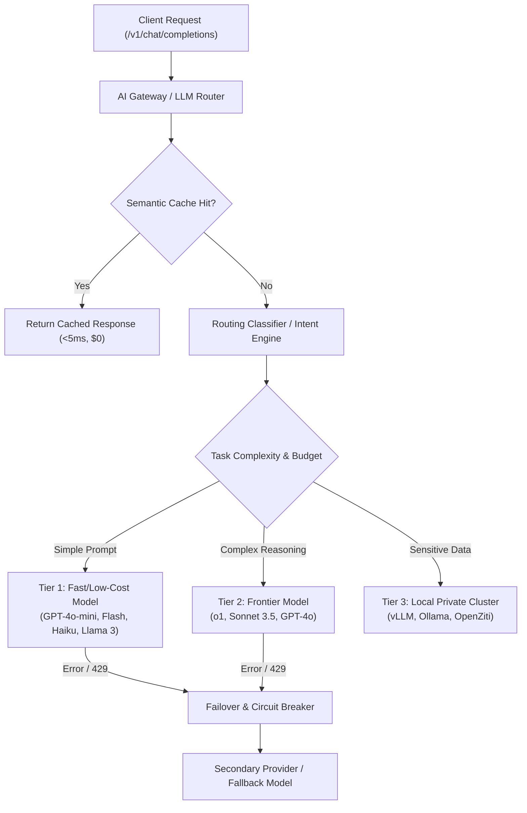

  

  
  
  
  
  
  

# 🚀 Awesome LLM Router

> **The definitive directory of intelligent LLM routers, AI gateways, and inference cost optimizers.**  
> Curated guide for engineering teams implementing **cost-aware model dispatching**, **zero-downtime provider failover**, **semantic request routing**, and **unified OpenAI-compatible proxy backbones**.

---

## 📌 Table of Contents
- [🔍 Overview & SEO Highlights](#-overview--seo-highlights)
- [🌐 Sector Overview & Market Dynamics](#-sector-overview--market-dynamics)
- [☁️ Top SaaS & Hosted LLM Routing Platforms](#️-top-saas--hosted-llm-routing-platforms)
- [💻 Top Open-Source LLM Routers & Gateways](#-top-open-source-llm-routers--gateways)
- [🏗️ Architectural Guide: Key Routing Paradigms](#️-architectural-guide-key-routing-paradigms)
- [🤝 How to Contribute](#-how-to-contribute)
- [⚠️ Disclaimer](#️-disclaimer)
- [⭐ Star History](#-star-history)
- [💖 Support & Sponsoring](#-support--sponsoring)

---

## 🔍 Overview & SEO Highlights

Modern production AI architectures sit on top of a multi-model foundation. An **LLM Router** (also known as an **AI Gateway** or **LLM Proxy**) operates as a high-performance proxy between client applications and model inference endpoints. Rather than hardcoding calls to a single proprietary model, routers dynamically inspect prompt tokens, task complexity, budgets, and real-time provider latency to dispatch each request to the optimal backend.

### 🎯 Key Architectural Pillars
- **💰 Intelligent Cost Optimization:** Route routine conversational turns or classification tasks to fast, low-cost models (e.g., GPT-4o-mini, Claude 3.5 Haiku, Gemini 1.5 Flash, Llama 3 8B), reserving frontier reasoning models (e.g., Claude 3.5 Sonnet, o1/o3, GPT-4o) exclusively for hard tasks—reducing token expenditure by **40% to 75%**.
- **🛡️ High Availability & Auto-Failover:** Transparently retry requests across alternative providers or local self-hosted fallbacks (e.g., Ollama, vLLM) when upstream rate limits (`HTTP 429`) or provider outages (`HTTP 5xx`) occur.
- **⚡ Semantic & Latency-Aware Routing:** Classify query intent using sub-millisecond embedding classifiers (bi-encoders) or calibrated matrix factorization thresholds to match prompts with specialized models.
- **🔐 Unified Interface & Key Governance:** Enforce per-user token quotas, virtual API keys, prompt guardrails, and compliance redaction through a single drop-in OpenAI-compatible API endpoint (`/v1/chat/completions`).

---

## 🌐 Sector Overview & Market Dynamics

The global AI Gateway, LLM Orchestration, and Inference Optimization market is estimated at **$1.8 Billion in 2024** and is projected to reach **$14.5 Billion by 2030**, compounding at a **CAGR of ~38.5%**, driven by widespread enterprise migration toward multi-model deployments and escalating token bills.

The sector is currently **moderately fragmented**: while proxy network protocols have consolidated around the standardized OpenAI API contract, no single vendor has achieved a winner-take-all monopoly. The ecosystem is bifurcating between global edge-network gateways focusing on network-level acceleration and security (e.g., Cloudflare, Kong), algorithmic decision layers optimizing cost-accuracy trade-offs (e.g., RouteLLM, Martian, NotDiamond), and highly customizable self-hosted open-source proxies (e.g., LiteLLM, Portkey Gateway, One API).

---

## ☁️ Top SaaS & Hosted LLM Routing Platforms

The table below outlines leading commercial and hosted LLM gateways, sorted in descending order by **Company Size (Valuation / Annual Revenue)**:

| 🏢 Platform | 📈 Valuation / Revenue (Company Size) | 💳 Starting Paid Tier Pricing | 🎁 Free Tier Limit | ⚙️ Core Capabilities & Routing Engine |
| :--- | :--- | :--- | :--- | :--- |
| **[Cloudflare AI Gateway](https://developers.cloudflare.com/ai-gateway/)** | **~$38 Billion** *(Public: NYSE: NET / $1.7B ARR)* | **Core gateway features free on all plans**; 5% fee on Unified Billing credits; Guardrails billed at Workers AI inference rates ($0.011/1K tokens) | **Free forever:** Unlimited caching, analytics, rate limiting, and 100,000 log events/month (10M logs on $5/mo Workers Paid) | Enterprise edge gateway running across Cloudflare's global anycast network. Provides response caching, rate limiting, DLP guardrails, and multi-provider failover. |
| **[Vercel AI Gateway](https://vercel.com/)** | **$3.25 Billion** *(Series E / $100M+ ARR)* | **Pro plan at $20/month per user** + usage-based compute/bandwidth ($0.15/GB, $0.06/hour edge middleware compute) | **Free forever Hobby plan:** 100 edge requests/day, 100 GB bandwidth, 1 GB storage (strictly non-commercial) | Edge-optimized model gateway native to Next.js and Vercel AI SDK. Features streaming failover, unified telemetry, and regional routing. |
| **[Inworld AI Router](https://inworld.ai/)** | **$500+ Million** *(Series A/B / $120M+ raised)* | **Pro plan starts at $20/month** for 2,000 interaction minutes; Scale plan at $1,000/month; Enterprise custom | **Free forever Starter plan:** 100 interaction minutes/month with access to core character engine and model routing | Low-latency routing layer engineered for real-time conversational agents, interactive NPC characters, and multimodal dialogue streams. |
| **[Braintrust](https://www.braintrust.dev/)** | **~$150 Million** *(Series A / $36M+ raised from a16z)* | **Pro plan starts at $249/month** (includes 5 GB data, 50,000 evaluation scores, 30-day retention; overage $0.005/score) | **Free forever Starter plan:** $10/month credit allowance, 1 GB processed data, 10,000 scores, 14-day retention | Enterprise AI proxy paired with online evaluations, prompt regression testing, cost attribution, and dataset curation. |
| **[Martian](https://withmartian.com/)** | **~$60 Million** *(Seed / $9M raised led by NEA)* | **Passthrough model cost + $0.0001 per routed call** (or 10% fee on verified cost savings) | **14-day free trial** with $20 credit allowance across all supported frontier and open models | Algorithmic Model Router that unpacks prompts into representation vectors to predict optimal model performance per query. |
| **[Portkey](https://portkey.ai/)** | **~$40 Million** *(Seed / $3M+ raised from Lightspeed)* | **Pro plan starts at $49/month** for 100,000 requests/month (overage $9 per 100K requests up to 3M); Enterprise custom | **Free forever Developer plan:** 10,000 requests/month, 10 virtual keys, and unlimited prompt templates | Production AI gateway featuring 50+ guardrails, load balancing, exponential retries, multimodal routing, and virtual API keys. |
| **[NotDiamond](https://www.notdiamond.ai/)** | **~$25 Million** *(Seed / Venture-backed)* | **Pro plan starts at $40/month** + $0.0005 per routed request + pass-through inference cost | **Free forever Community plan:** 100,000 routed queries/month with automated benchmark routing | Dynamic routing engine maximizing accuracy-to-cost tradeoffs by dispatching prompts between Claude 3.5, GPT-4o, and Gemini. |
| **[Unify AI](https://unify.ai/)** | **~$20 Million** *(Seed / $8M raised)* | **Pro tier starts at $30/seat/month** with custom routing strategies; 0% markup on standard provider endpoints | **Free forever Starter plan:** $10 instant sign-up credit + 1,000 routed requests/day across unified endpoints | Multi-provider router optimizing latency, cost, and throughput across global inference endpoints with live benchmarking. |
| **[OpenRouter](https://openrouter.ai/)** | **~$15 Million** *(Profitable bootstrapped / $10M+ ARR run-rate)* | **5.5% transaction fee on deposit purchases** ($0.80 minimum deposit); 0% markup on model token list prices; BYOK free up to $25k/mo list value | **Free forever:** 50 requests/day with no credits required across 15+ community models (boosted to 1,000/day with $10 deposit) | Unified API gateway routing to 300+ models with automated fallback, real-time uptime healthchecks, and BYOK support. |
| **[Manifest](https://manifest.build/)** | **~$10 Million** *(Seed / Early Stage)* | **Team plan starts at $39/month** for up to 250,000 routed tokens; Enterprise starting at $350/month | **14-day free trial** with 50,000 smart-routed tokens across OpenAI, Anthropic, and Cohere | Complexity-based routing proxy that dynamically selects lightweight models for simple prompts and frontier models for complex tasks. |
| **[ClawRouter](https://clawrouter.com/)** | **~$5 Million** *(Indie / Early Stage)* | **Starter tier starts at $19/month** for 100,000 failover queries; $0.00015/query thereafter | **Free forever tier:** 2,500 queries/month with dual-provider failover and latency tracking | Agent-native router with <1ms local routing overhead, crypto/micropayments routing, and automatic failover. |

---

## 💻 Top Open-Source LLM Routers & Gateways

Open-source projects empower developers to self-host their inference infrastructure, retain full data privacy, and eliminate third-party vendor lock-in.

The list below is sorted in descending order by **GitHub Star Count**:

### 1. ⚡ [LiteLLM](https://github.com/BerriAI/litellm) 
- **GitHub:** `BerriAI/litellm` | **License:** MIT
- **Architecture:** High-performance proxy with Rust core and Python SDK translating OpenAI-format calls to 100+ LLM providers.
- **Key Features:** Virtual keys, spend tracking per user/team, load balancing across keys, automatic retries/fallbacks, and comprehensive admin UI.
- **Best For:** Default standard for teams seeking a self-hosted, transparent gateway they fully control.

### 2. 🔀 [New API](https://github.com/QuantumNous/new-api) 
- **GitHub:** `QuantumNous/new-api` | **License:** MIT
- **Architecture:** High-performance Go model aggregation and distribution hub with Web UI.
- **Key Features:** Cross-converts various LLM endpoints into OpenAI-, Claude-, or Gemini-compatible APIs; granular token billing, multi-user quotas, and channel weight balancing.
- **Best For:** Enterprise model distribution, internal AI service platforms, and high-concurrency key multiplexing.

### 3. 🦍 [Kong AI Gateway](https://github.com/Kong/kong) 
- **GitHub:** `Kong/kong` | **License:** Apache-2.0
- **Architecture:** Enterprise-grade cloud-native API and AI Gateway built on NGINX / OpenResty.
- **Key Features:** Native AI plugins for prompt engineering, semantic caching, model load balancing, rate limiting, and egress data masking.
- **Best For:** Large enterprises already running Kong who want to unify traditional microservice APIs and LLM inference under one control plane.

### 4. 🌐 [One API](https://github.com/songquanpeng/one-api) 
- **GitHub:** `songquanpeng/one-api` | **License:** MIT
- **Architecture:** Lightweight single-binary Go gateway for aggregating and redistributing LLM API endpoints.
- **Key Features:** Supports OpenAI, Azure, Claude, Gemini, DeepSeek, and domestic backends; user management, token usage counters, and Docker-ready deployment.
- **Best For:** Developers and small teams wanting a fast, single-binary LLM proxy with zero infrastructure baggage.

### 5. 🚀 [Apache APISIX AI Gateway](https://github.com/apache/apisix) 
- **GitHub:** `apache/apisix` | **License:** Apache-2.0
- **Architecture:** Dynamic, ultra-high-performance cloud-native API gateway built on NGINX and etcd.
- **Key Features:** First-class AI plugins for multi-provider routing, fallback chains, prompt security guardrails, and token-based rate limiting.
- **Best For:** High-throughput production environments requiring dynamic hot-reloading of routing rules without server restarts.

### 6. 🛡️ [Portkey AI Gateway (OSS)](https://github.com/Portkey-AI/gateway) 
- **GitHub:** `Portkey-AI/gateway` | **License:** MIT
- **Architecture:** Blazing-fast TypeScript proxy (9.9x lower latency than traditional proxies) routing to 1,600+ LLMs.
- **Key Features:** 50+ pre-call and post-call guardrails, weighted load balancing, exponential backoff retries, request timeouts, and fallback policies.
- **Best For:** Production systems requiring guardrails, governance, and strict SLA uptime across multiple vendors.

### 7. 🏛️ [Plano (formerly Arch)](https://github.com/katanemo/plano) 
- **GitHub:** `katanemo/plano` | **License:** Apache-2.0
- **Architecture:** AI-native proxy server and data plane built on Envoy for agentic applications.
- **Key Features:** Sub-millisecond prompt routing, prompt guardrails, agent orchestration primitives, and built-in tracing.
- **Best For:** Complex agentic workflows and multi-agent systems demanding high-throughput networking.

### 8. ⚡ [ClawRouter (OSS)](https://github.com/BlockRunAI/ClawRouter) 
- **GitHub:** `BlockRunAI/ClawRouter` | **License:** MIT
- **Architecture:** Agent-native router designed for autonomous agents and decentralized systems.
- **Key Features:** <1ms local routing decisions, multi-wallet settlement on Base & Solana via x402, and automatic provider failover.
- **Best For:** Web3 and autonomous agent infrastructure requiring decentralized billing and high-speed execution.

### 9. 🧊 [Helicone](https://github.com/Helicone/helicone) 
- **GitHub:** `Helicone/helicone` | **License:** Apache-2.0
- **Architecture:** Open-source LLM observability platform and smart proxy (YC W23).
- **Key Features:** One line of code integration, semantic caching, cost tracking, rate limiting, and prompt evaluation.
- **Best For:** Teams wanting instant visibility into token spend, latency bottlenecks, and prompt regression testing.

### 10. 🧠 [vLLM Semantic Router](https://github.com/vllm-project/semantic-router) 
- **GitHub:** `vllm-project/semantic-router` | **License:** Apache-2.0
- **Architecture:** Open decision layer created by the vLLM team for hybrid cloud/local compute routing.
- **Key Features:** Programmable routing policies, embedding-based query classification, and dynamic offloading between local GPU clusters and external APIs.
- **Best For:** Teams running self-hosted vLLM inference instances alongside commercial cloud providers.

### 11. ⚖️ [RouteLLM](https://github.com/lm-sys/RouteLLM) 
- **GitHub:** `lm-sys/RouteLLM` | **License:** Apache-2.0
- **Architecture:** Groundbreaking research framework from LMSYS for training, evaluating, and serving LLM routers.
- **Key Features:** Calibrated matrix factorization, similarity-weighted ranking, and BERT router classifiers trained on Chatbot Arena benchmark data; cuts costs by >2x without sacrificing response quality.
- **Best For:** AI engineers needing mathematically rigorous, benchmark-calibrated routing between strong and weak models.

### 12. 🎯 [Aurelio Semantic Router](https://github.com/aurelio-labs/semantic-router) 
- **GitHub:** `aurelio-labs/semantic-router` | **License:** Apache-2.0
- **Architecture:** Superfast vector-based decision layer executing semantic classification in under 2ms.
- **Key Features:** Vector embedding index that maps user utterances to predefined routes or domain-specific tools without calling an LLM.
- **Best For:** Agent workflows, intent classification, and deterministic guardrail routing prior to model invocation.

### 13. 🔒 [OpenZiti LLM Gateway](https://github.com/openziti/llm-gateway) 
- **GitHub:** `openziti/llm-gateway` | **License:** Apache-2.0
- **Architecture:** Zero-Trust LLM gateway with overlay networking via OpenZiti / zrok.
- **Key Features:** End-to-end encryption across private networks without exposing firewall ports, semantic routing, and virtual API keys.
- **Best For:** Regulated industries (healthcare, defense, fintech) routing queries to private vLLM/Ollama clusters over untrusted networks.

### 14. 🛡️ [radlab-llm-router](https://pypi.org/project/radlab-llm-router/)
- **Distribution:** PyPI | **Deployment:** Docker & Helm
- **Key Features:** 5 load-balancing heuristics (balanced, weighted, dynamic_weighted, first_available, first_available_optim), semantic BiEncoder routing, RAG plugin, and caller-facing error masking.
- **Best For:** Production Kubernetes microservices needing comprehensive payload sanitization and advanced load balancing.

### 15. 👻 [GhostRouter](https://pypi.org/project/ghostrouter/)
- **Distribution:** PyPI | **Architecture:** Async-native Python HTTP daemon
- **Key Features:** Self-learning routing layer across 10+ providers with trust tiers, circuit breakers, budget caps, and post-model data redaction.
- **Best For:** Systems prioritizing security boundaries, audit traces, and adaptive multi-provider fallbacks.

---

## 🏗️ Architectural Guide: Key Routing Paradigms

### 1. Strong-to-Weak Model Routing (Threshold Routing)
Frameworks like **RouteLLM** evaluate prompt complexity scores against calibrated thresholds. If complexity < threshold, the request is served by an inexpensive model (e.g., GPT-4o-mini); otherwise, it is escalated to a frontier model. This achieves near-frontier quality at a fraction of the cost.

### 2. Semantic Intent & Tool Routing
Vector-based routers like **Aurelio Semantic Router** match prompt embeddings against semantic centroids in <2ms, bypassing prompt-based LLM triage entirely for common flows like FAQ lookups, small talk, and deterministic API calls.

### 3. Failover Chains & Circuit Breaking
When upstream providers encounter latency spikes or downtime, gateways like **LiteLLM**, **Portkey**, and **Cloudflare** seamlessly retry alternative providers (e.g., Azure OpenAI -> AWS Bedrock -> Anthropic direct) within the same HTTP connection.

---

## 🤝 How to Contribute

Contributions from the AI engineering community are warmly welcomed!

1. 🍴 **Fork the repository** on GitHub.
2. 📝 **Add or update an entry in `README.md`** following the established format:
   - Include: Name, website or GitHub repository link, starting pricing, free tier details, and architectural highlights.
   - For open-source projects, include the official GitHub star badge formatted as:  
     ``
3. 🧪 **Verify all links and factual claims**.
4. 🚀 **Submit a Pull Request** with a clear explanation of your addition.

---

## ⚠️ Disclaimer

- This is a **community-curated index** for informational and architectural purposes; inclusion does not constitute commercial endorsement.
- Routing thresholds and fallback logic directly impact output quality and end-user experience. Always calibrate routing boundaries on your specific domain dataset before deploying to production.
- Self-hosted gateways introduce infrastructure and network latency overheads (typically 10ms–40ms); verify these operational characteristics against your system's SLA requirements.

---

## ⭐ Star History

---

## 💖 Support & Sponsoring

Thank you for exploring **Awesome-LLM-Router**! If this curated guide helps you architect more reliable, cost-efficient, and performant AI systems, please consider supporting the project:

- ⭐ **Star this repository** to help other AI engineers and developers discover it.
- 🍴 **Fork and contribute** by submitting PRs for new tools, gateways, and routing strategies.
- 📢 **Share with peers**, your team, and AI engineering communities on Twitter, LinkedIn, and Discord.
- ☕ **Sponsor the maintainer** / buy a coffee via the [GitHub Sponsor Dashboard](https://github.com/sponsors/ishandutta2007).

---

  Maintained with ❤️ by <a href="https://github.com/ishandutta2007">Ishan Dutta</a> and the open-source AI community.

